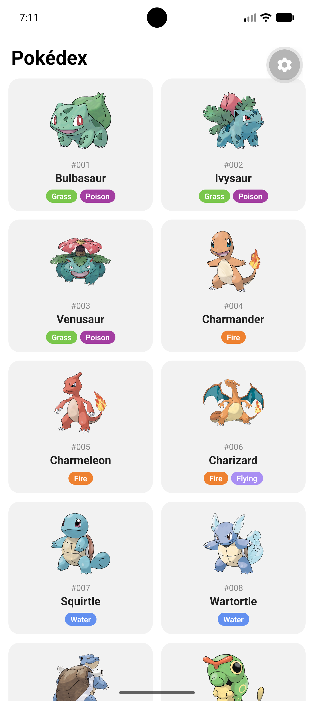
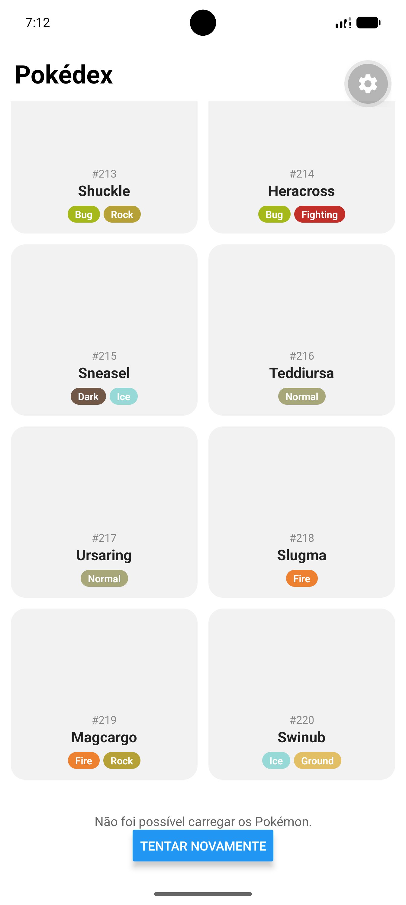

# Pokédex

Aplicativo mobile que lista os Pokémon da [PokéAPI](https://pokeapi.co/) em uma grade com rolagem infinita, mostrando imagem, número na Pokédex Nacional, nome e tipos. Tocar em um Pokémon reproduz o grito dele.

Atividade individual da disciplina Programação de App (Engenharia de Software, UCB, 2026/2), sobre consumo de web services.

   

<p align="center">
  
  &nbsp;&nbsp;
  
</p>

## Sumário

- [Funcionalidades](#funcionalidades)
- [Requisitos da atividade](#requisitos-da-atividade)
- [Arquitetura](#arquitetura)
- [Stack](#stack)
- [Estrutura do repositório](#estrutura-do-repositório)
- [Como executar](#como-executar)
- [Qualidade](#qualidade)
- [Fluxo de trabalho](#fluxo-de-trabalho)
- [Limitações conhecidas](#limitações-conhecidas)
- [Roadmap](#roadmap)
- [Créditos](#créditos)
- [Autor](#autor)
- [Licença](#licença)

## Funcionalidades

- **Listagem paginada:** os 20 primeiros Pokémon aparecem ao abrir o app, e os 20 seguintes são carregados quando a rolagem se aproxima do fim da lista.
- **Card por Pokémon:** arte oficial, número no formato `#006`, nome e tipos com a cor de cada um, na ordem primário e secundário.
- **Grito:** tocar no card reproduz o grito do Pokémon, com a versão atual dos jogos ou, na falta dela, a original.
- **Estados de carregamento e erro:** na primeira página, a tela inteira mostra o carregamento ou o erro. Nas seguintes, os dois aparecem no rodapé, e a lista já carregada continua visível. Um botão permite tentar de novo a mesma página.

## Requisitos da atividade

| Requisito | Onde está atendido |
| --- | --- |
| Seguir a documentação da PokéAPI | Endpoints `/pokemon` (lista) e `/pokemon/{id}` (detalhe), em [`src/services/pokeApi.ts`](src/services/pokeApi.ts) |
| Listar primeiro os 20 primeiros Pokémon | Primeira página carregada ao montar a tela, em [`src/hooks/usePokemonList.ts`](src/hooks/usePokemonList.ts) |
| Ao arrastar, requisitar os próximos 20 | `onEndReached` da `FlatList` chama `loadMore`, que avança o `offset` de 20 em 20 |
| Exibir imagem, número, nome e tipagem | [`src/components/PokemonCard.tsx`](src/components/PokemonCard.tsx) |

## Arquitetura

```
┌───────────────────────────────────────────────┐
│ PokedexScreen                                 │
│   ├── usePokemonList ──▶ pokeApi ─────────────┼──HTTPS──▶ PokéAPI
│   ├── usePokemonCry ───▶ expo-audio ──────────┼──HTTPS──▶ arquivos .ogg dos gritos
│   └── FlatList ────────▶ PokemonCard (×N)     │
└───────────────────────────────────────────────┘
```

Cada camada tem uma responsabilidade: o service fala com a API e lança erros, os hooks guardam estado e tratam esses erros, e a tela e os componentes só desenham o que recebem. Decisões principais:

- **Requisições concorrentes:** a lista da PokéAPI traz só nome e URL de cada Pokémon. Imagem, tipos e grito vêm do detalhe, então cada página faz 1 requisição de lista e 20 de detalhe. As 20 são disparadas juntas com `Promise.all`, que mantém a ordem da lista, e o tempo da página fica próximo ao da resposta mais lenta, não à soma das 20.
- **Resposta da API separada do model:** [`src/types/pokemon.ts`](src/types/pokemon.ts) descreve o JSON aninhado da API (`...Response`) e, à parte, o tipo `Pokemon`, plano, que a interface usa. A conversão acontece em um único ponto do service, e os componentes não conhecem o formato da API.
- **Paginação sem requisições duplicadas:** o `onEndReached` pode disparar várias vezes seguidas. O `offset` e uma trava de "requisição em andamento" ficam em `useRef`, que muda na hora, e não em `useState`, que só se atualiza na renderização seguinte. Se uma página falha, o `offset` não avança, e tentar novamente pede a mesma página.
- **Um player de áudio para a tela:** em vez de um player por card, um único `AudioPlayer` troca de fonte a cada toque. Isso evita manter centenas de players nativos abertos durante a rolagem, e um grito novo interrompe o anterior.
- **Permissões mínimas:** o config plugin do `expo-audio` está restrito a reprodução em [`app.json`](app.json). O app não pede microfone nem reprodução em segundo plano.

## Stack

- Expo SDK 58, React Native 0.88, React 19 e TypeScript 6
- `expo-audio` para os gritos
- `react-native-safe-area-context` para respeitar barra de status e navegação
- `fetch` nativo, sem biblioteca HTTP

## Estrutura do repositório

```
.
├── App.tsx                 provedor de área segura e tela inicial
├── app.json                nome, ícones e config plugins
├── assets/                 ícone do app e splash
├── docs/screenshots/       imagens usadas neste README
└── src/
    ├── components/         PokemonCard
    ├── config/             URL base da API e tamanho da página
    ├── hooks/              usePokemonList (paginação) e usePokemonCry (áudio)
    ├── screens/            PokedexScreen
    ├── services/           cliente da PokéAPI e conversão para o model
    ├── theme/              cores dos tipos
    └── types/              tipos da resposta da API e model Pokemon
```

## Como executar

### Pré-requisitos

- Node.js LTS
- Android com Expo Go em versão compatível com o SDK 58, ou um emulador do Android Studio

### Passos

```bash
git clone https://github.com/Takesh0s/pokedex-react-native.git
cd pokedex-react-native
npm install
npx expo start
```

Escaneie o QR code com o Expo Go, com o celular na mesma rede do computador, ou pressione `a` com um emulador aberto. Se a rede bloquear a conexão entre os aparelhos, use `npx expo start --tunnel`.

O app não precisa de chave de API nem de variáveis de ambiente: a PokéAPI é pública.

### Problemas comuns

- **`INSTALL_FAILED_INSUFFICIENT_STORAGE` no emulador:** o armazenamento interno do dispositivo virtual está cheio. No Device Manager do Android Studio, aumente o *Internal storage*, execute *Wipe Data* e depois *Cold Boot Now*.

## Qualidade

```bash
npx tsc --noEmit
```

O TypeScript roda em modo `strict`, então campos que a API pode devolver como `null`, como a imagem e o grito, precisam ser tratados antes do uso.

## Fluxo de trabalho

O repositório segue o GitHub Flow: cada mudança nasce em uma branch a partir de `main` (`feat/*`, `chore/*`) e volta por pull request. As mensagens de commit seguem o [Conventional Commits](https://www.conventionalcommits.org/pt-br/).

## Limitações conhecidas

- Os gritos são arquivos `.ogg`, formato que o Android reproduz e o iOS não. O app foi desenvolvido e testado só no Android.
- Se uma das 20 requisições de detalhe falhar, a página inteira é tratada como erro, porque o `Promise.all` rejeita na primeira falha.
- No fim da lista, a PokéAPI inclui formas especiais (como as megaevoluções) com números acima de 10000, que não pertencem à Pokédex Nacional. Algumas não têm imagem e aparecem com um marcador no lugar.

## Roadmap

- Busca por nome e filtro por tipo
- Tela de detalhes com estatísticas, habilidades e evoluções
- Testes do service e do hook, com execução no GitHub Actions
- Reprodução de áudio compatível com iOS

## Créditos

- Dados, imagens e gritos: [PokéAPI](https://pokeapi.co/), [PokeAPI/sprites](https://github.com/PokeAPI/sprites) e [PokeAPI/cries](https://github.com/PokeAPI/cries)

Pokémon e os nomes relacionados são marcas registradas da Nintendo, Game Freak e The Pokémon Company. Este é um projeto acadêmico, sem fins comerciais e sem vínculo com essas empresas.

## Autor

Luiz Phillipe de Souza Santos ([@Takesh0s](https://github.com/Takesh0s))

## Licença

Distribuído sob a licença MIT. Consulte o arquivo [LICENSE](LICENSE).